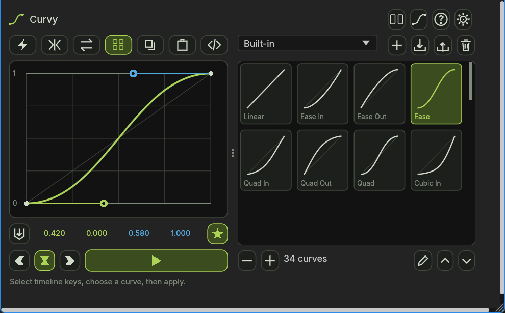
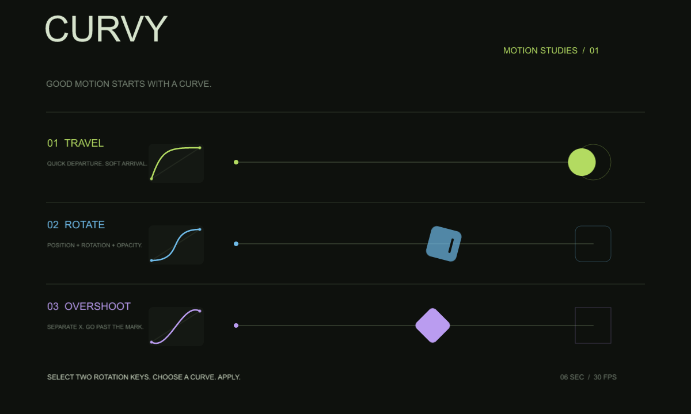

# Curvy 1.1.0

Curvy is a native, dockable EffectCraft curve editor with an interactive cubic Bézier graph, icon buttons, and a gallery of **34 easing presets**. Its graph-and-library workflow follows Flow's public interface, while the dark green surfaces, lime accents, blue incoming handles, rounded buttons, and drawn icons match the neighboring Key Lime script.

Curvy is an independent EffectCraft implementation. It contains no Flow vendor code, artwork, or bundled plugin assets. It uses EffectCraft's native scripting and undo commands; it is not an Adobe After Effects extension.



Verified with **EffectCraft 0.17.0**.

## Install and open

1. In EffectCraft, choose **File → Scripts → Install ScriptUI Panel…**.
2. Select **`dist/Curvy.jsx`** from this folder.
3. Choose **Window → Curvy.jsx**.

The installed panel is one standalone file. It needs no network access, companion process, external fonts, or separate icon files at runtime. Dock it beside the timeline or float its tab.

Use the panel's **compact/wide layout control** to choose content suited to the available space. Drag the dotted divider to adjust the graph and gallery proportions. EffectCraft currently does not send dock-resize events to ScriptUI, so resizing the outer dock alone does not resize Curvy's contents. A dock smaller than the selected content size shows EffectCraft's outer scrollbars.

On Windows, `node install.mjs` installs the built file into `%APPDATA%\EffectCraft\Scripts\ScriptUI Panels\Curvy.jsx`. If it replaces different existing contents, it saves that version in this project's `archive/` folder. Reopen the panel after updating it.

## Start easing

1. Open a composition and select **at least two adjacent keyframes** on each property to edit.
2. Click a preset thumbnail, drag the graph handles, or click the four coordinates for exact values.
3. Choose incoming, both, or outgoing easing, then click the **triangle** to apply.

Curvy edits adjacent selected intervals. A gap between selected keys is left untouched. Multiple properties and layers can be processed together. Each completed application produces one native Undo step; validation happens before the timeline is changed.

The graph is normalized: horizontal position is progress through an interval, and vertical position is progress between its endpoint values. It does not display the property's absolute values. The graph expands vertically for anticipation and overshoot. Lime identifies the outgoing handle; blue identifies the incoming handle.

## Controls and shortcuts

| Control | Action |
|---|---|
| Triangle | Apply the displayed curve to selected keyframe intervals. |
| Incoming / both / outgoing icons | Choose which temporal easing sides to change. The other side is preserved. |
| Read icon | Load the first selected interval's native easing. Ctrl-click reads a Curvy expression. The selected ease direction controls which handle is read. |
| Four coordinates | Edit `x1, y1, x2, y2`, or paste a CSS `cubic-bezier(...)` value. |
| Star | Save the current curve to the active library. A filled star indicates a matching saved curve. |
| Lightning | Toggle auto-apply. Selecting or changing a curve applies it; a handle drag applies when released. |
| Mirror | Link both handles symmetrically around the graph's center. |
| Opposing arrows | Reverse the curve's easing in time. |
| Grid icon | Show or hide the preset gallery. |
| Header curve / split icons | Show or hide the editor; switch compact / wide content layouts. |
| Copy / paste icons | Open a text dialog for transferring plain Bézier coordinates or CSS values. Use the text field's normal copy/paste shortcuts. |
| Code brackets | Toggle the application mode between native keyframes and a Curvy expression. |
| Gear / question mark | Preferences and the shortcut guide. |

| Gesture | Result |
|---|---|
| Drag a graph handle | Adjust its time and value coordinates. |
| Shift-drag | Snap to the configured grid and constrain movement to an axis. |
| Alt-drag | Preserve the handle's angle while changing its length. |
| Ctrl-drag | Preserve the handle's length while changing its angle. |
| Shift+Ctrl-drag | Mirror the two handles. |
| Shift-click Apply | Apply incoming easing. |
| Alt-click Apply | Apply outgoing easing. |
| Ctrl-click Apply | Apply as a Curvy expression. |
| Shift+Ctrl-click Apply | Apply the reversed curve using the selected direction and application mode. |

Preferences include auto-apply, a previous-curve reference line, mirrored handles, tooltips, graph/library orientation, and grid density. Reopen the panel after changing tooltip visibility to update every existing control. Curve values, libraries, preset order, and preferences persist through EffectCraft's settings storage.

## Preset gallery and libraries

The built-in gallery starts with the full 25-curve reference set: Linear; Ease In, Ease Out, Ease; and incoming, outgoing, and both-sided Quad, Cubic, Quart, Quint, Expo, Circ, and Back curves. The reference Ease curve is `0.42, 0, 0.58, 1`.

Nine additional curves retain AE Easy Ease, the Sine family, CSS curves, and Snappy, for **34 presets** in total. The previous Ease curve remains available as AE Easy Ease. Existing installations receive missing presets once, while custom names, edited curves, and user libraries are preserved. The polynomial-family entries are cubic Bézier approximations.

- **Click** a thumbnail to load its curve; **double-click** to apply it immediately.
- **Drag** thumbnails to reorder them. The arrows and gallery scrollbar browse additional rows.
- **Right-click** a thumbnail, or use the pencil, to edit its name and coordinates or delete it.
- Use the library dropdown to switch collections. **Plus** creates a library; **Shift-plus** renames it.
- The library trash button deletes the active library. The thumbnail **minus/plus** buttons change gallery tile size.
- Preferences can restore the built-in collection as a new library without replacing existing collections.

Curvy supports up to 64 libraries and 1,024 presets per library. Names are limited to 80 characters. Curves require finite coordinates: X values from 0 to 1, and Y values from −20 to 20.

## Import, export, and copying

The library import/export dialogs accept pasted JSON or a full local file path. Import **adds** the incoming presets to the active library. It does not replace the library.

- **`.json`** exports Curvy's versioned library format, including the library name and preset IDs.
- **`.flow`** exports the Flow-compatible JSON mapping from preset names to comma-separated coordinate strings. This format was checked against the official public Google Material Design preset pack. Flow export requires unique preset names.
- Imports accept either format, as well as a JSON array of named Curvy presets. Input is parsed as data, never evaluated as code. Files must be smaller than 2 MB.

For example, this is a valid `.flow` library:

```json
{
  "Standard": "0.4, 0, 0.2, 1",
  "Sharp": "0.4, 0, 0.6, 1"
}
```

Saving a library to disk requires EffectCraft's **Allow Scripts to Write Files** permission under **Preferences → Scripting & Expressions**. Copying JSON from the dialog works without enabling file writes. Curvy does not change the permission automatically. Exporting over an existing file first creates a sibling `.bak`; if that backup already exists, choose another filename.

## EffectCraft behavior and limits

- **Native easing:** applying a curve preserves key times, values, and the unaffected easing side. Speeds are scaled to each interval's duration and value change. Spatial Position uses motion-path length, including curved paths, rather than a single coordinate's distance. Reversed and stretched layers are handled in layer time.
- **Selection requirements:** locked layers, selected roving keys, and properties without Bézier interpolation are rejected. Turn off Roving or unlock the layer before applying. Native keyframe mode rejects enabled expressions so an expression cannot silently mask the result.
- **Endpoint influence:** EffectCraft's native easing cannot represent a zero-width temporal handle. Keyframe mode limits affected endpoint influences to 0.1% and reports the adjustment. Expression mode preserves the exact cubic curve.
- **Reading curves:** only the first selected interval is read. For vector properties with different easing per dimension, Curvy reads the dominant changing dimension. A moving curve with equal endpoint values cannot be normalized and produces an error. Hold interpolation has no cubic curve to read.
- **Overshoot:** curved spatial Position paths cannot overshoot their endpoints through this bridge. Separate Position dimensions to use anticipation or overshoot there. Property-specific host value limits still apply; Curvy does not reproduce Flow's clip/skip/separate-dimensions prompt.
- **Expressions:** expression mode supports numeric scalar/vector properties with selected adjacent keys. Separate spatial Position dimensions first. It updates an existing Curvy expression, but does not overwrite unrelated expressions. Outside the chosen intervals it preserves the property's existing value. Intervals follow moved keys; after inserting or deleting keys, reapply the expression. When the key count changes, the expression falls back to the underlying value until reapplied. There is no expression-append operation or no-keyframe expression template.
- **Host differences:** the dock chrome, explicit compact/wide sizing, dialogs, and some preferences differ from Flow's CEP interface. KBar is an After Effects integration and is unavailable in EffectCraft. Flow's licensing, updater, and vendor-specific expression policies are not part of Curvy.

## Demo project

Open **Curvy Demo.ecproj** for a six-second motion study with travel, rotation/opacity, and separated-position overshoot. It uses native shapes and contains no external media. Select the blue token's Rotation keyframes to try Curvy; saved projects do not retain timeline key selection.



## Build

The release includes a standalone panel and editable JavaScript source. Build from this folder with Node.js:

```sh
node build.mjs
```

The build combines `src/core.js`, `src/host.js`, and `src/panel.js` into `dist/Curvy.jsx` and writes its SHA-256 checksum. There are no npm dependencies to install.

Curve evaluation, preset upgrades, native easing, and panel interactions have been checked locally. Development tests, local settings, logs, and generated working files are excluded from this repository and its release archives.

| File | Purpose |
|---|---|
| `dist/Curvy.jsx` | Standalone installable panel. |
| `dist/Curvy.jsx.sha256` | SHA-256 checksum of the panel. |
| `src/core.js` | Curve mathematics, preset collection, validation, and library formats. |
| `src/host.js` | EffectCraft selection, easing conversion, expressions, and undoable edits. |
| `src/panel.js` | Native interface, vector icons, graph interaction, gallery, and storage. |
| `Curvy Demo.ecproj` | Ready-to-open motion study with no external media. |
| `CHANGELOG.md` | Release history. |

## Public references

- [Flow product page](https://aescripts.com/flow/) and [official interface screenshot](https://aescripts.com/media/wysiwyg/renderTom/flow/interface-full.png).
- [Flow graph editor](https://flow.lova.tt/#/interface/graph-editor), [controls](https://flow.lova.tt/#/interface/controls), and [preset library](https://flow.lova.tt/#/interface/library).
- [Flow appearance](https://flow.lova.tt/#/preferences/appearance), [behavior](https://flow.lova.tt/#/preferences/behaviour), and [expression documentation](https://flow.lova.tt/#/extra/expressions).
- [Official Google Material Design preset sample](https://flow.lova.tt/assets/presets/google/google-material-design.zip), used to verify the public `.flow` interchange format.

The implementation and runtime icon drawings are authored for Curvy. The references establish the interaction model and file interchange behavior; they are not bundled dependencies.
